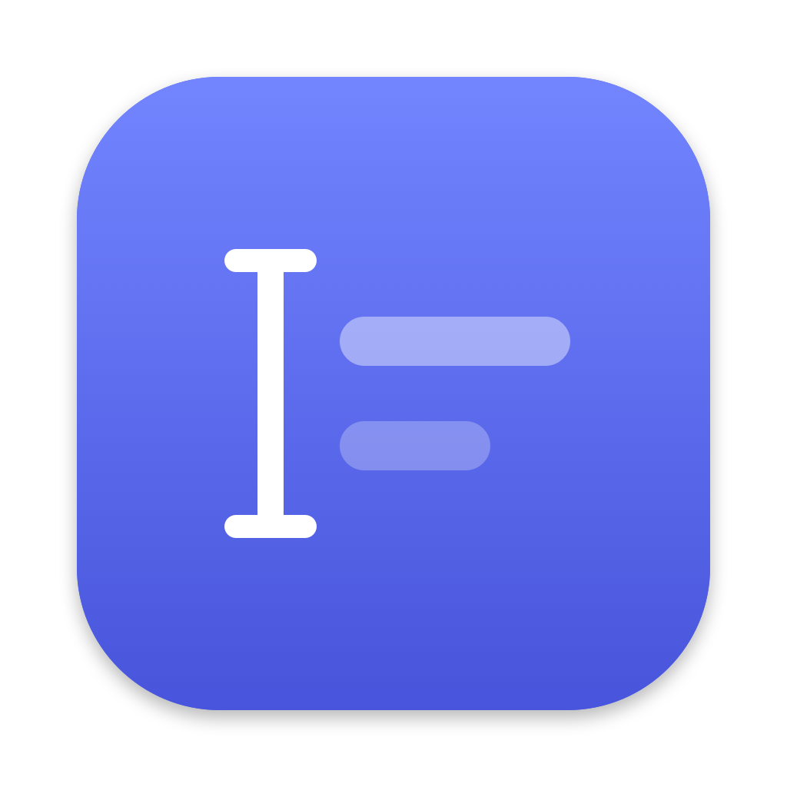
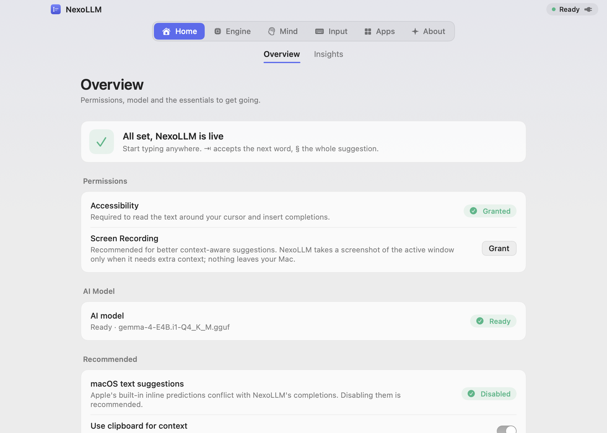
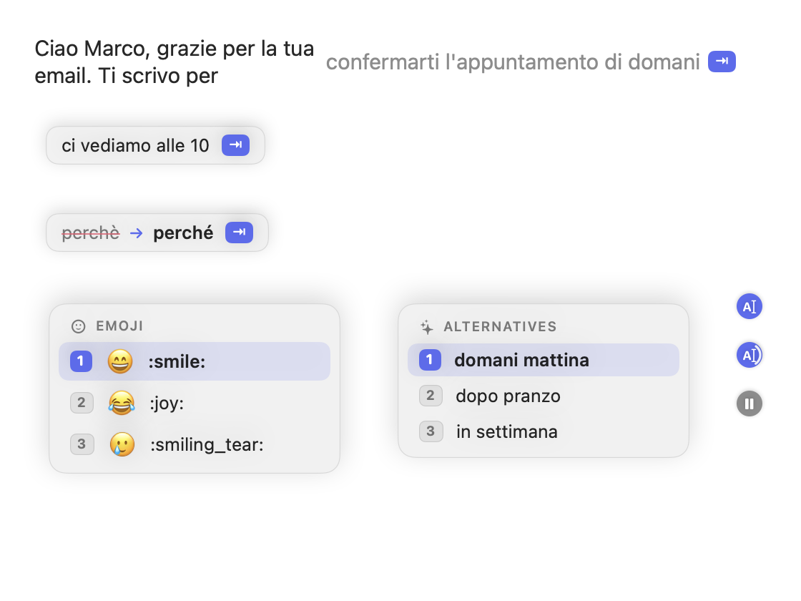

# NexoLLM

**Il tuo Mac finisce le frasi al posto tuo. E non manda niente a nessuno.**

  
  
  
  
  

[Scarica](https://github.com/NexoLLM/NexoLLM/releases/latest) · [Novità](CHANGELOG.md) · [Privacy](PRIVACY.md) · [Segnala un problema](https://github.com/NexoLLM/NexoLLM/issues/new/choose)

[English](README.md) | Italiano

 

 

## Cos'è

NexoLLM è un motore di scrittura che vive nella barra dei menu. Mentre scrivi in Mail, Messaggi, WhatsApp,
Note, Pages, Safari, Slack o Obsidian ti propone come continua la frase, in grigio, subito dopo il cursore.
Premi `Tab` per prendere la parola successiva, oppure continua a scrivere e lo ignori.

Il modello linguistico gira sulla GPU Apple Silicon del tuo Mac. Niente account, niente abbonamento, niente
server: quello che scrivi, la tua cronologia e quello che l'app impara di te restano sul tuo disco, cifrati.

Fa caso al momento. Scrivi "dal 19 al 23" nell'oggetto di una mail e inizia la stessa frase nel testo:
NexoLLM la completa con 23, perché ha letto l'oggetto, non perché ha tirato a indovinare.

 

## Come funziona

Ogni suggerimento passa dagli stessi quattro passaggi, in pochi decimi di secondo.

<table>
  <tr>
    <td width="70" align="center"><b>01</b></td>
    <td><b>Legge il momento</b> Il testo attorno al cursore e i campi brevi vicini (oggetto, destinatari,
    titolo di una nota), tramite l'Accessibilità di macOS. Se vuoi, anche la finestra: premendo
    <code>⌃⌥S</code>, oppure in automatico solo quando serve. Lo schermo diventa testo sul Mac e non viene mai
    salvato.</td>
  </tr>
  <tr>
    <td align="center"><b>02</b></td>
    <td><b>Si ricorda di te</b> Come scrivi in ogni app (formale in Mail, breve in chat), le espressioni che
    usi, come apri e chiudi un messaggio, e una piccola memoria degli argomenti degli ultimi giorni che
    sbiadisce da sola.</td>
  </tr>
  <tr>
    <td align="center"><b>03</b></td>
    <td><b>Ragiona sul Mac</b> Gemma 4 (E4B, oppure E2B a batteria) con llama.cpp su Metal. La cache del
    prompt viene riusata mentre scrivi, numeri e nomi presi dal contesto vengono copiati esatti e, quando il
    modello non è sicuro, semplicemente propone meno.</td>
  </tr>
  <tr>
    <td align="center"><b>04</b></td>
    <td><b>Scrive solo quello che accetti</b> Un <code>Tab</code> per parola. La punteggiatura vuole il suo
    <code>Tab</code>, così una virgola che non volevi non finisce mai nel testo. Il grigio si adatta alla pagina
    sotto il cursore e resta leggibile anche su una pagina bianca in modalità scura.</td>
  </tr>
</table>

 

## Guardalo

 

## Installazione

| | |
|---|---|
| **1. Scarica** | Prendi `NexoLLM-<versione>.dmg` dalle [Release](https://github.com/NexoLLM/NexoLLM/releases/latest) e trascina l'app in Applicazioni. |
| **2. Primo avvio** | La beta non è ancora notarizzata. Clic destro sull'app, Apri, poi conferma. Si fa una volta sola. |
| **3. Permessi** | Accessibilità serve per leggere e inserire il testo. Registrazione schermo è facoltativa e serve solo per il contesto dello schermo. |
| **4. Modello** | Metti un modello Gemma 4 GGUF (E4B o E2B, Q4_K_M) in `~/Library/Application Support/NexoLLM/Models`. La pagina Panoramica ti dice se manca qualcosa. |

Requisiti: macOS 14 o successivo su Apple Silicon, 8 GB di memoria (16 GB consigliati per E4B).

 

## Tasti

| Azione | Tasto |
|---|---|
| Prendi la parola successiva (la punteggiatura è un tasto a parte) | `Tab` |
| Prendi tutto il suggerimento | il tasto sopra `Tab` |
| Ignora | `Esc` |
| Chiedi un suggerimento adesso | `⌃` + il tasto sopra `Tab` |
| Leggi lo schermo adesso | `⌃⌥S` |
| Alternative, o sinonimi della parola selezionata | `⌥Tab` |
| Pausa nell'app corrente | `⌃⌥⌘` + il tasto sopra `Tab` |

Si cambiano tutti nelle Impostazioni, alla voce Input.

 

## Privacy

NexoLLM non apre connessioni di rete. La cronologia di scrittura e la memoria sono cifrate con AES-256-GCM
con una chiave tenuta nel Portachiavi, dentro una cartella leggibile solo dal tuo utente. I campi password e
l'input sicuro non vengono mai letti. Tutti i dettagli sono in [PRIVACY.md](PRIVACY.md).

 

## A che punto è

NexoLLM è una beta ed è ancora lontano dalla 1.0. Tra una versione e l'altra le cose cambieranno, e le tue
segnalazioni decidono cosa viene dopo: dimmi cosa stavi scrivendo e in quale app, e ci guardo.

 

## Licenza

NexoLLM è gratuito e proprietario. Il codice sorgente non è pubblico e l'app non può essere ridistribuita
né modificata. Vedi [LICENSE](LICENSE). Include llama.cpp, rilasciato con licenza MIT.

 
Fatto da <b>EdevS</b>

