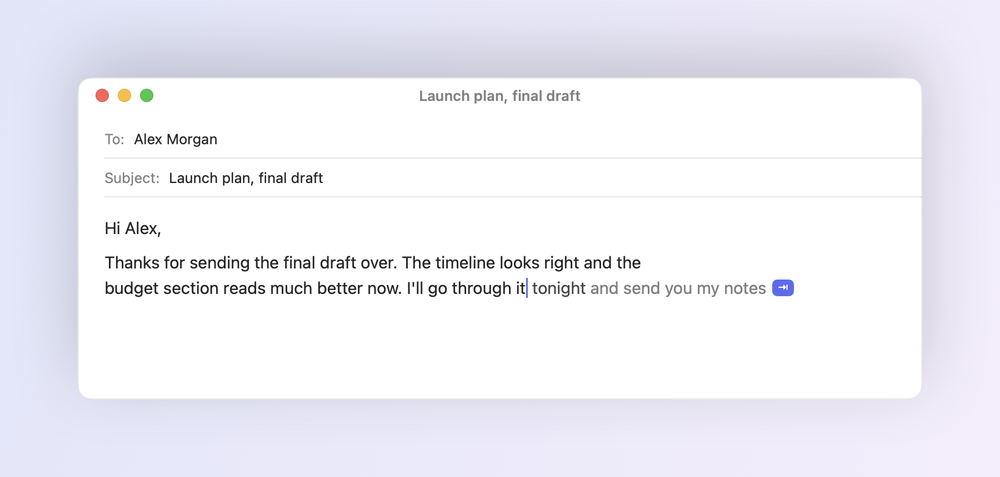
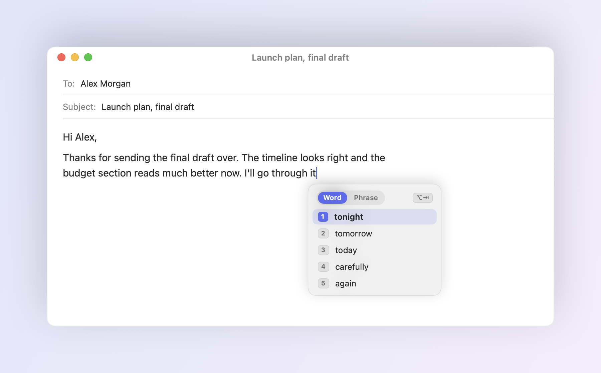
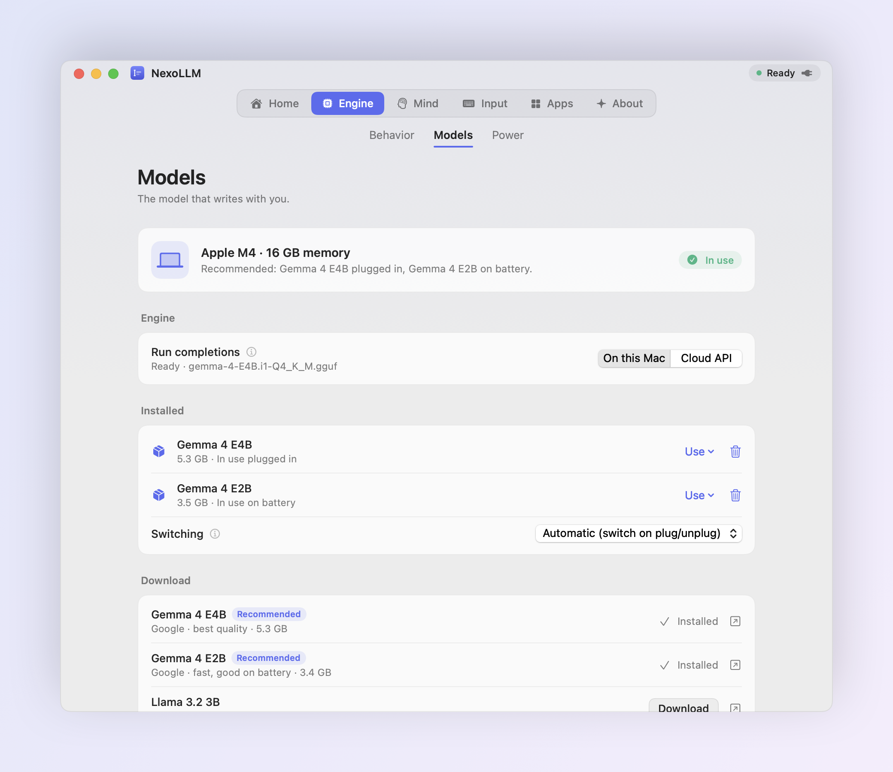

# NexoLLM

Autocomplete for every app on your Mac. 
Runs a local model on Apple Silicon, or the API you already pay for.

 

  

  

<picture>
  <source media="(prefers-color-scheme: dark)" srcset="assets/hero-dark.png">
  
</picture>

## What it does

NexoLLM sits in the menu bar and suggests the rest of your sentence, in grey, right after the cursor.
<kbd>Tab</kbd> takes the next word, the key above it takes the whole suggestion, and if you keep typing
it simply goes away. It works wherever you write: Mail, Messages, Slack, Notes, Pages, Safari, Chrome,
Obsidian and most other apps.

It reads more than the line you're on. Names, dates and numbers in the subject or the recipient field
carry over into the body. Your past writing teaches it your tone, per app, and a short encrypted memory
keeps track of what you've been writing about lately.

 

<table>
<tr>
<td width="50%" valign="top">

**Words that make sense** 
Suggestions start from the half-typed word, so the obvious word is the one you get. Punctuation always
takes its own <kbd>Tab</kbd>, so you decide where a sentence ends.

</td>
<td width="50%" valign="top">

**Other options, one key away** 
<kbd>⌥</kbd> <kbd>Tab</kbd> lists other words for the one you're typing. Press it again to see other ways
to finish the sentence. Select a word to get synonyms.

</td>
</tr>
<tr>
<td valign="top">

**Local or cloud** 
Pick a model for your Mac and download it from Settings, or paste an OpenAI, Anthropic, Gemini or
OpenRouter key and use that instead.

</td>
<td valign="top">

**Out of the way** 
No floating buttons. The menu bar icon shows the status, and <kbd>⌃</kbd> <kbd>⌥</kbd> <kbd>M</kbd> opens
the menu right at the cursor.

</td>
</tr>
</table>

 

<picture>
  <source media="(prefers-color-scheme: dark)" srcset="assets/alternatives-dark.png">
  
</picture>

## Install

1. Download [NexoLLM.dmg](https://github.com/EdoQueloBelo/NexoLLM/releases/latest/download/NexoLLM.dmg) and drag NexoLLM to Applications.
2. The beta isn't notarized yet. The first time, right-click the app and choose **Open**.
3. Allow **Accessibility** when asked. Screen Recording is optional.
4. Open **Settings → Engine → Models** and click **Use Recommended**. NexoLLM picks models that fit your Mac's memory and downloads them.

Requires macOS 14 or later on Apple Silicon. 8 GB of memory works, 16 GB is recommended.

## Keys

| | |
|---|---|
| Accept the next word | <kbd>Tab</kbd> |
| Accept the whole suggestion | the key above <kbd>Tab</kbd> |
| Dismiss | <kbd>Esc</kbd> |
| Alternatives (press again to switch word / phrase) | <kbd>⌥</kbd> <kbd>Tab</kbd> |
| Open the menu at the cursor | <kbd>⌃</kbd> <kbd>⌥</kbd> <kbd>M</kbd> |
| Read the screen for context | <kbd>⌃</kbd> <kbd>⌥</kbd> <kbd>S</kbd> |
| Suggest now | <kbd>⌃</kbd> + the key above <kbd>Tab</kbd> |

All of them can be changed in Settings → Input.

## Models

<picture>
  <source media="(prefers-color-scheme: dark)" srcset="assets/settings-models-dark.png">
  
</picture>

NexoLLM checks your chip and memory and recommends a model for when you're plugged in and a lighter one
for battery. Downloads come straight from Hugging Face and are verified with SHA-256 before they're used.
You can also import any GGUF file, and delete models you don't need to get the space back.

| Model | Size | Good for |
|---|---|---|
| Gemma 4 E4B | 5.3 GB | Best quality, 16 GB Macs |
| Gemma 4 E2B | 3.4 GB | Fast, battery, 8 GB Macs |
| Llama 3.2 3B | 2.0 GB | Smallest, English |

With a cloud key, suggestions come from the provider you choose. Keys stay in your Keychain.

## Privacy

With a local model nothing leaves your Mac: no account, no analytics, no network. Your writing history and
memory are encrypted with a key kept in the Keychain, and password fields are never read. In cloud mode
the text around the cursor goes to the provider you picked, and only to them. Details in
[PRIVACY.md](PRIVACY.md).

## Feedback

NexoLLM is in beta. If a suggestion is wrong or something breaks, [open an issue](https://github.com/EdoQueloBelo/NexoLLM/issues/new/choose)
and say which app you were in. Release notes are in the [changelog](CHANGELOG.md).

## License

Free to use. NexoLLM is proprietary software: the source code is not published, and redistributing or
modifying the app isn't allowed. See [LICENSE](LICENSE). It includes llama.cpp (MIT).

 
Made by EdevS

